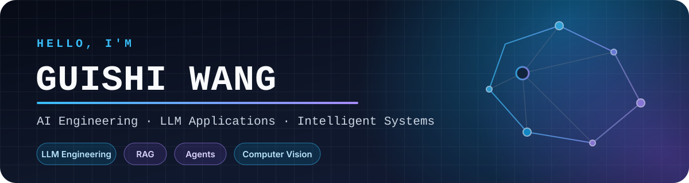

  

  

  
  

## 👋 About Me

我主要关注 **AI 工程化**：从 RAG、智能体与大模型网关，到文档智能和计算机视觉。比起只做 Demo，我更喜欢把模型能力做成可复用、可维护、可验证的系统。

- 🤖 构建 LLM 应用、模型接入网关与多智能体工作流
- 🔎 探索中文语义检索、Reranker 与文档知识处理
- 👁️ 持续关注计算机视觉、目标检测与图像理解
- 🧱 重视系统可靠性、可观测性与清晰的工程边界

## 🚀 Featured Projects

- **[Guishi-Skills](https://github.com/guishiw/Guishi-Skills)** — 面向数据分析、文档、演示、研究和代码库理解的可复用 Codex Skills 集合。
- **[model-switch](https://github.com/guishiw/model-switch)** — 统一大模型 API 网关，包含多渠道路由、限流、熔断、队列、审计和可视化管理。
- **[terms-rag](https://github.com/guishiw/terms-rag)** — 面向中文招标条款的离线 RAG 检索系统，使用 BGE、Reranker、ChromaDB 与 FastAPI。

## 🧰 Tech Stack

### Languages

  
  
  
  

### AI, Backend & Infrastructure

  
  
  
  
  
  
  
  

## 📊 GitHub Stats

  <picture>
    <source media="(prefers-color-scheme: dark)" srcset="https://github-readme-stats.vercel.app/api?username=guishiw&amp;show_icons=true&amp;hide_border=true&amp;theme=github_dark&amp;rank_icon=github" />
    <source media="(prefers-color-scheme: light)" srcset="https://github-readme-stats.vercel.app/api?username=guishiw&amp;show_icons=true&amp;hide_border=true&amp;theme=default&amp;rank_icon=github" />
    
  </picture>
  <picture>
    <source media="(prefers-color-scheme: dark)" srcset="https://github-readme-stats.vercel.app/api/top-langs/?username=guishiw&amp;layout=compact&amp;hide_border=true&amp;theme=github_dark&amp;langs_count=8" />
    <source media="(prefers-color-scheme: light)" srcset="https://github-readme-stats.vercel.app/api/top-langs/?username=guishiw&amp;layout=compact&amp;hide_border=true&amp;theme=default&amp;langs_count=8" />
    
  </picture>

## 🤝 Let's Connect

如果你也在关注 **LLM 工程化、RAG、智能体、文档智能或计算机视觉**，欢迎通过 GitHub 交流想法与项目。

  

  Build useful things. Keep learning. Stay curious.

