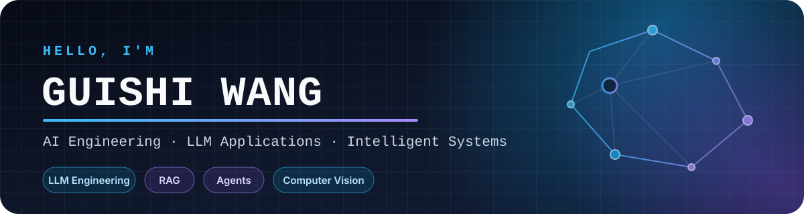

  

  

  
  

## 👋 About Me

I'm **Guishi Wang**, an AI and software engineer focused on turning model capabilities into dependable products. I work across LLM applications, retrieval, agent workflows, document intelligence, computer vision, and the backend systems that keep them reliable.

I also contribute focused fixes to open-source projects. My usual workflow is simple: reproduce the issue, find the root cause, keep the change narrow, and add regression coverage for the edge cases that matter.

- **AI systems:** LLM gateways, provider routing, RAG, agents, and evaluation workflows
- **Document intelligence:** parsing, semantic retrieval, reranking, and structured review
- **Applied vision:** object detection, image similarity, and multimodal processing
- **Production engineering:** APIs, concurrency, caching, observability, and maintainable system boundaries

## 🚀 Featured Projects

| Project | What it does |
| --- | --- |
| **[Guishi-Skills](https://github.com/guishiw/Guishi-Skills)** | Reusable Codex skills for data analysis, publishing, presentations, research, and codebase understanding. |
| **[model-switch](https://github.com/guishiw/model-switch)** | An OpenAI-compatible LLM gateway with multi-provider routing, rate limits, circuit breaking, queues, auditing, and an admin console. |
| **[terms-rag](https://github.com/guishiw/terms-rag)** | An offline RAG system for Chinese tender clauses using BGE embeddings, reranking, ChromaDB, and FastAPI. |

## ✅ Merged Open-Source Contributions

Every contribution listed below has been **merged into the upstream project**.

| Project | Merged work |
| --- | --- |
| **[InvokeAI](https://github.com/invoke-ai/InvokeAI)** | [#10076](https://github.com/invoke-ai/InvokeAI/pull/10076) Diffusers Anima LoRA mapping · [#10060](https://github.com/invoke-ai/InvokeAI/pull/10060) factorized LyCORIS layouts · [#10059](https://github.com/invoke-ai/InvokeAI/pull/10059) Anima kohya non-block mapping · [#10058](https://github.com/invoke-ai/InvokeAI/pull/10058) FLUX PEFT alpha preservation · [#10050](https://github.com/invoke-ai/InvokeAI/pull/10050) Qwen-Image multimodal token types · [#10048](https://github.com/invoke-ai/InvokeAI/pull/10048) convolution-shaped LoHa factors |
| **[MoneyPrinterTurbo](https://github.com/harry0703/MoneyPrinterTurbo)** | [#1742](https://github.com/harry0703/MoneyPrinterTurbo/pull/1742) Redis-backed global task concurrency · [#1743](https://github.com/harry0703/MoneyPrinterTurbo/pull/1743) consistent enum defaults · [#1744](https://github.com/harry0703/MoneyPrinterTurbo/pull/1744) atomic repair of corrupt cached videos |
| **[Playwright](https://github.com/microsoft/playwright)** | [#43713](https://github.com/microsoft/playwright/pull/43713) disallow skips in `after` hooks |
| **[cc-switch](https://github.com/farion1231/cc-switch)** | [#8998](https://github.com/farion1231/cc-switch/pull/8998) restore Codex reasoning effort after re-enabling it |

  <a href="https://github.com/search?q=author%3Aguishiw+is%3Apr+is%3Amerged&type=pullrequests"><strong>View all merged pull requests →</strong></a>

## 🧰 Tech Stack

  
  
  
  

  
  
  
  
  
  

## 📊 GitHub Stats

  <picture>
    <source media="(prefers-color-scheme: dark)" srcset="https://github-readme-stats.vercel.app/api?username=guishiw&amp;show_icons=true&amp;hide_border=true&amp;theme=github_dark&amp;rank_icon=github" />
    <source media="(prefers-color-scheme: light)" srcset="https://github-readme-stats.vercel.app/api?username=guishiw&amp;show_icons=true&amp;hide_border=true&amp;theme=default&amp;rank_icon=github" />
    
  </picture>
  <picture>
    <source media="(prefers-color-scheme: dark)" srcset="https://github-readme-stats.vercel.app/api/top-langs/?username=guishiw&amp;layout=compact&amp;hide_border=true&amp;theme=github_dark&amp;langs_count=8" />
    <source media="(prefers-color-scheme: light)" srcset="https://github-readme-stats.vercel.app/api/top-langs/?username=guishiw&amp;layout=compact&amp;hide_border=true&amp;theme=default&amp;langs_count=8" />
    
  </picture>

## 🤝 Let's Connect

If you're working on **LLM engineering, RAG, agents, document intelligence, computer vision, or open-source infrastructure**, feel free to connect through GitHub.

  

  Build useful things. Keep learning. Stay curious.

